# Minecraft Splitscreen for Steam Deck

2–4 player splitscreen Minecraft Java 26.3 as **one AppImage window**, so Steam's Game Mode (gamescope) shows
every player at once instead of focusing a single game window. Each player gets their own controller.

How it works: the AppImage starts a nested KWin (already on SteamOS) as one window. Inside it, one Minecraft
client per player is tiled: top/bottom or side by side (your choice), four in quadrants. Each player picks a
profile (name and skin). Whatever world Player 1 opens is shared on LAN, and Players 2–4 join it automatically.
A small Fabric mod (`glue-mod/`) does the joining, the profiles, the window titles and the controller
assignment. Controlify handles the controller input itself.

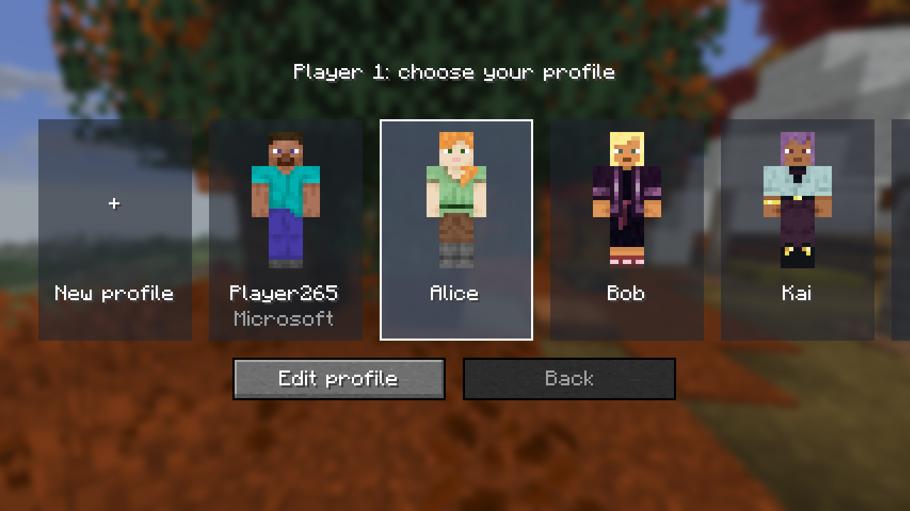

## Requirements
- Steam Deck (SteamOS 3.8+), or any Linux desktop with KWin 6.
- [Prism Launcher](https://prismlauncher.org) from Flathub (Discover → Prism Launcher), signed in with a Microsoft
  account that owns Minecraft. Close Prism before starting the AppImage.
- About 2.5 GB RAM per player. Four players fit in the Deck's 16 GB, with lower render distances for guests.

## Install
1. Download `MinecraftSplitscreen-*.AppImage` from Releases into `~/Applications/` and make it executable
   (Dolphin: Properties → Permissions → "Is executable").
2. Open Prism Launcher once, add your Microsoft account (Accounts → Manage Accounts → Add Microsoft), then close
   it.
3. In Desktop Mode, Steam → Add a Game → Add a Non-Steam Game → Browse → pick the AppImage.
4. Switch to Game Mode and launch it.

The first launch creates Prism instances `P1`–`P4` (Minecraft 26.3 + Fabric + the mods) and the offline guest
accounts, and Prism downloads Minecraft and Java 25. Every launch refreshes the mods in those instances, so a new
AppImage takes effect by itself (`--setup` only does that step and exits).

## Profiles
Every view starts by asking **Choose your profile**: Player 1 before the main menu, the others before they join.
- **Create profile** is always the first card. Pick a skin (Minecraft's 9 built-in skins, or your own), choose
  classic or slim arms, type a name on the on-screen keyboard, then Create.
- **Custom skins:** put 64×64 skin PNGs in `~/Documents/Minecraft Skins`. They show up the next time you launch.
- **Player 1** can also play as the **Microsoft account**, with its real skin. Online servers need that.
- **In use:** a profile someone else is using is greyed out.
- **Edit profile** changes a profile's skin or deletes it. Names can't change, because each world keeps a
  profile's inventory under its name. Inventories are per world, as in normal Minecraft.
- Player 1 can switch profile from **Splitscreen → Profile** on the title screen.

| Creating a profile | The profile in game |
| --- | --- |
| 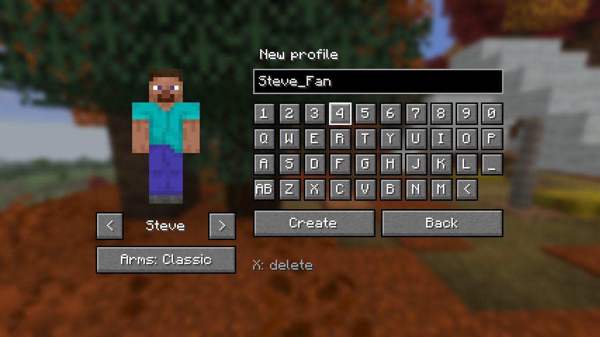 | 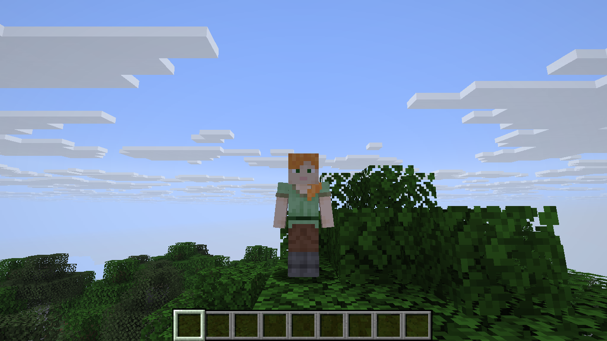 |

## Players and controllers
P1 starts alone:
- The first controller to press any button is Player 1. The game doesn't go on to the menus until it knows Player
  1's controller and profile.
- Every other controller that presses START becomes the next player and gets its own view (about 30 s to load).
  That works at any time, up to 4 players. While Player 1 is alone, a reminder pops up now and then.
- A new view shows **Waiting for Player 1's world…** (guests never see the menus) and "Press any button on your
  controller". After a couple of presses it finds its controller. It joins Player 1's world as soon as it's
  open. **Back** returns to profile selection, where **Leave** closes that view.
- Player 1 opens or creates any world. The others join it as soon as it's open, and rejoin by themselves if
  Player 1 switches worlds.
- **Players 2–4 leave** by leaving the world (Disconnect in their pause menu): their view closes straight away.
  The players after them move up a place, and a new join goes on the end. When Player 1 closes or switches
  worlds, the others stay and rejoin the next one.
- **Player 1 quitting ends the whole session** and closes the AppImage.
- If a controller disconnects, its player keeps their place. START on any free controller reconnects them.
- The **Splitscreen** button (top left of Player 1's title screen and pause menu) opens Splitscreen settings:
  - **Layout:** Horizontal (stacked: 2 players top/bottom; with 3, Player 1 across the top) or Vertical (side by
    side: 2 players left/right; with 3, Player 1 down the left). 4 players are always quadrants. It switches
    immediately and is remembered.
  - **Players:** who is playing with which controller.

Every layout, captured on a Steam Deck (each view at its real size; the profiles are Alice, Bob, Kai and Zuri):

| | Horizontal | Vertical |
| --- | --- | --- |
| **2 players** | 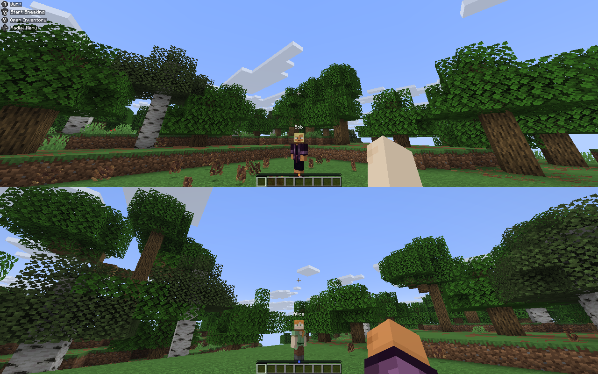 | 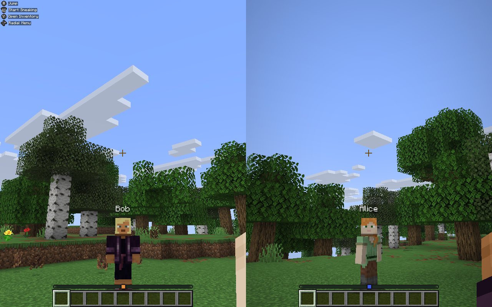 |
| **3 players** | 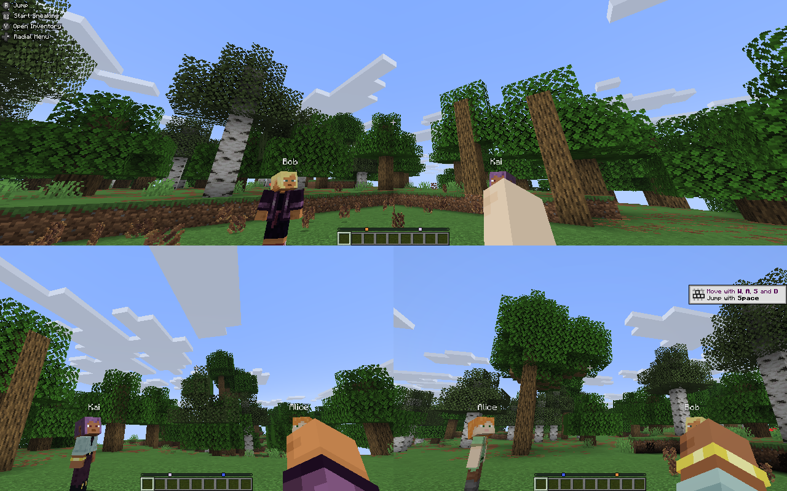 | 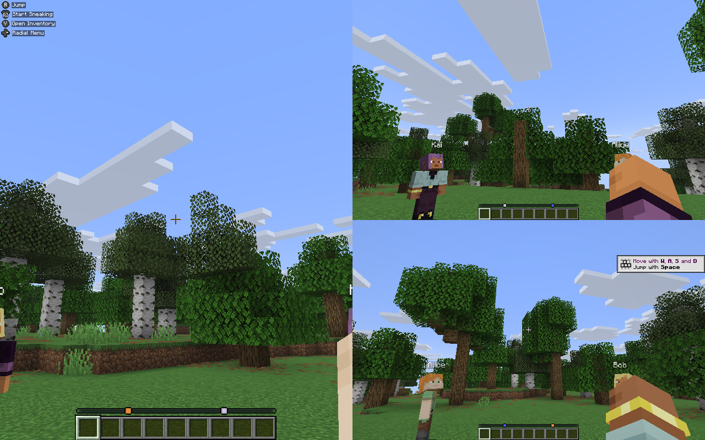 |
| **4 players** | 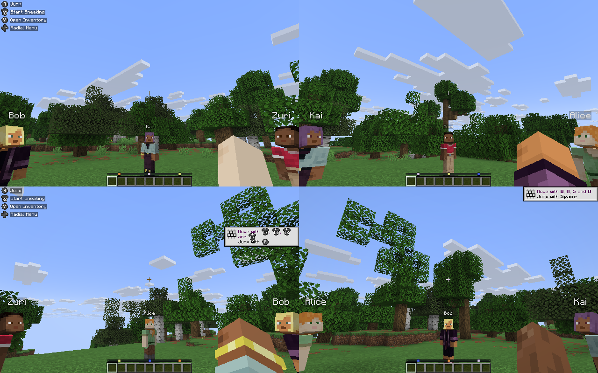 | (always quadrants) |

| A guest waiting for the world | Splitscreen settings | Player 1's pause menu |
| --- | --- | --- |
| 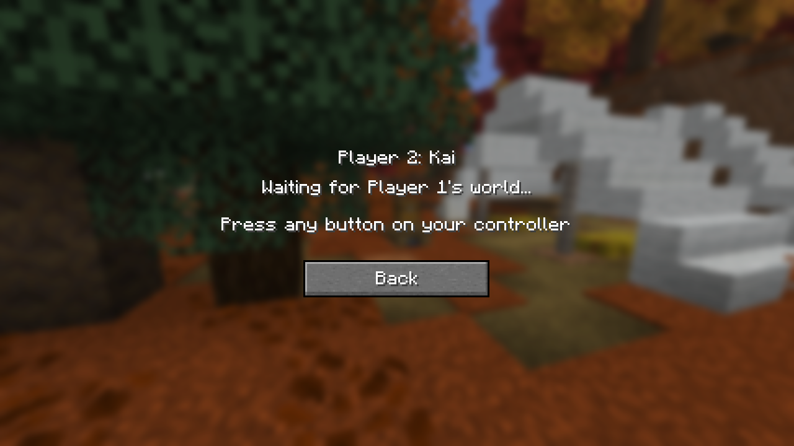 | 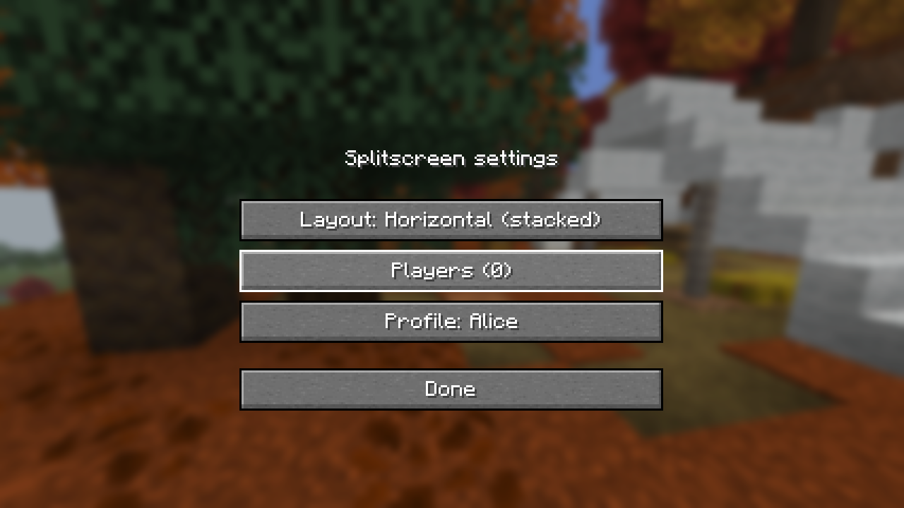 | 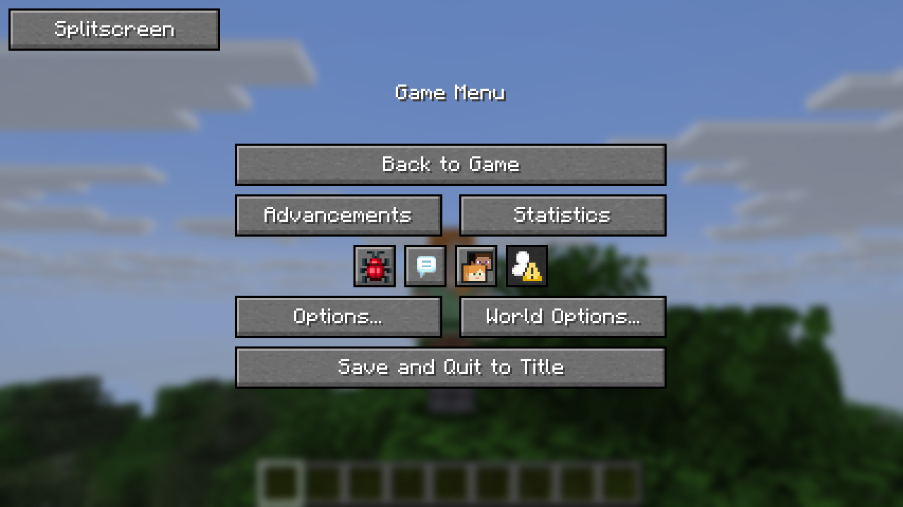 |

The menu screenshots come from one desktop window (`MCSS_DEV_SHOTS=<folder> ./gradlew runClient` in `glue-mod/`,
see `DevShots.java`). On the Deck the same screens fill each player's part of the split screen. The layout
pictures come from the real AppImage on a Deck (`scripts/deck-split.py`, see `DevSplit.java`).

Under Steam the clients read the real controllers, not Steam Input's virtual pads. Steam's virtual pads all look
the same to the game, so they can't be told apart.

## Keeping up with new Minecraft versions
`.github/workflows/minecraft-watch.yml` runs every day. It also has a manual **Run workflow** button, which can
test any version, including snapshots.
- It compares Mojang's latest release with the version this repo is pinned to (`glue-mod/gradle.properties`).
- For a newer version, it checks:
  - that Fabric, Fabric API, Controlify, YACL and Sodium have builds for it;
  - that the glue mod compiles against it;
  - the **in-game smoke test** (`scripts/smoke-test.sh`). The real client runs under a virtual display, goes
    through every screen and creates a world, so a failed mixin, a crash or a missing screen fails it.
- It opens an issue **"Minecraft <version> support"** with the results, logs and screenshots, and adds to it
  every day until the version is supported.
- When everything passes, it also opens a PR with the new version pins.

The same smoke test runs on every push and pull request, and a release is only published if it passes.

## Logs
`~/.local/state/mc-splitscreen/` holds `apprun.log`, `kwin.log` and `prism.log`. Each client's game log is in
Prism's `instances/P<n>/minecraft/logs/latest.log`.

## Building
```
scripts/fetch-mods.sh        # Fabric API, Controlify, YACL, Sodium from Modrinth (SHA-1 checked) -> dist/mods
scripts/build-appimage.sh    # glue mod + AppImage -> dist/MinecraftSplitscreen-x86_64.AppImage
```
Needs a JDK 25 (`JAVA_HOME`, or unpacked in `.tools/`), python3 with Pillow, and curl. CI
(`.github/workflows/release.yml`) builds on every push. Pushing a `v*` tag publishes the AppImage as a GitHub
release.

The AppImage contains no Minecraft or Prism Launcher files. The game is downloaded by your own Prism Launcher with
your own account.
