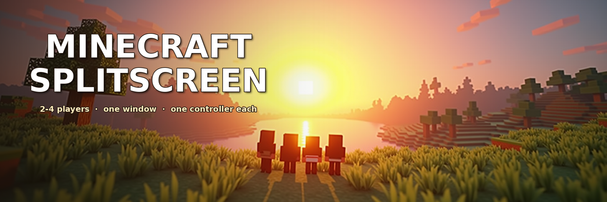
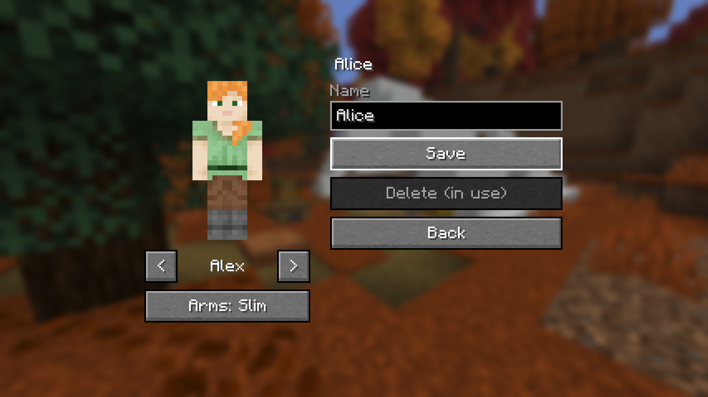
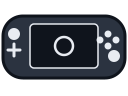
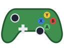
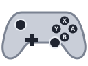
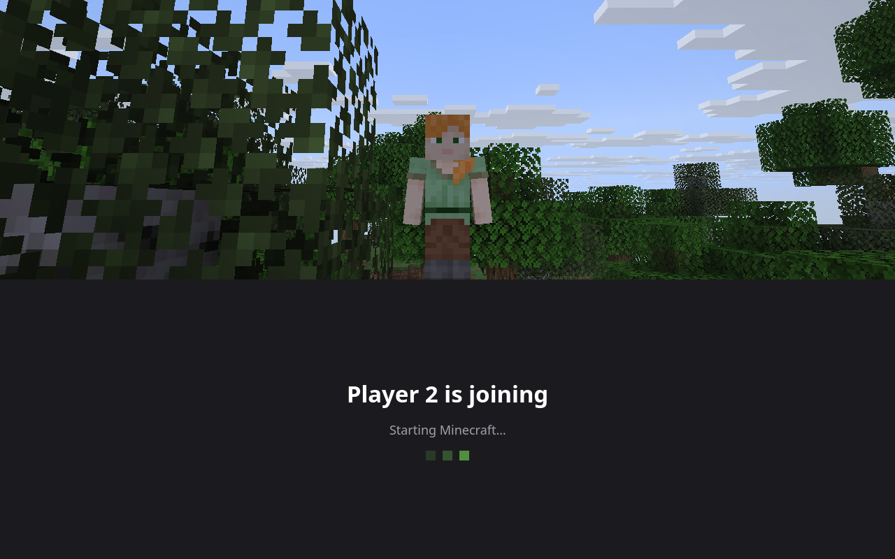
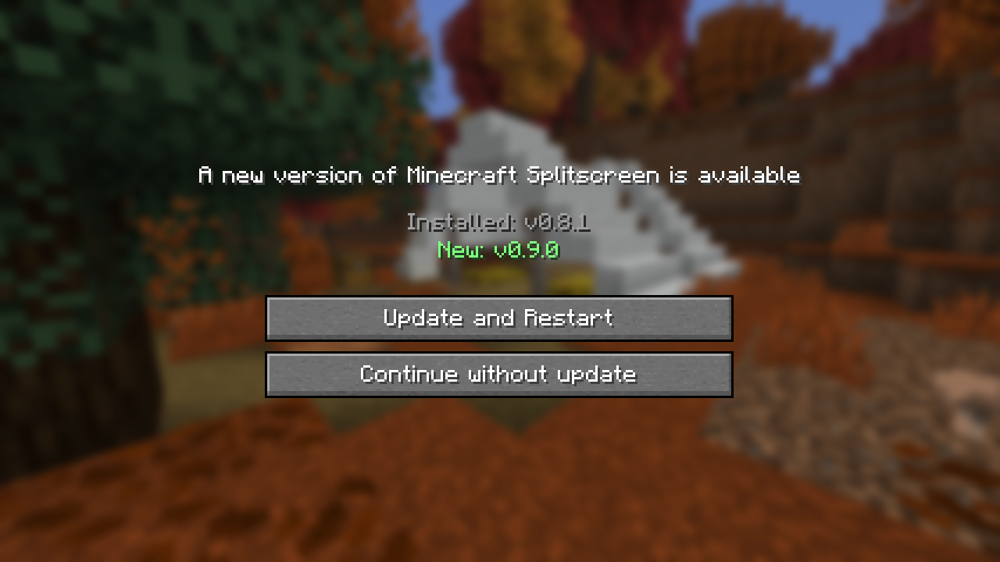

<p align="center"></p>

# Minecraft Splitscreen for Steam Deck

2–4 player splitscreen Minecraft Java 26.3 as **one AppImage window**, so Steam's Game Mode (gamescope) shows
every player at once instead of focusing a single game window. Each player gets their own controller.

How it works: the AppImage starts a nested KWin (already on SteamOS) as one window. Inside it, one Minecraft
client per player is tiled: top/bottom or side by side (your choice), four in quadrants. Each player picks a
profile (name and skin). Whatever world Player 1 opens is shared on LAN, and Players 2–4 join it automatically.
A small Fabric mod (`glue-mod/`) does the joining, the profiles, the window titles and the controller
assignment. Controlify handles the controller input itself.

**[⬇ Download the latest AppImage](https://github.com/dwatson251/minecraft-splitscreen/releases/latest/download/MinecraftSplitscreen-x86_64.AppImage)**
(x86_64; older versions and release notes are on the [releases page](https://github.com/dwatson251/minecraft-splitscreen/releases))


## Requirements
- Steam Deck (SteamOS 3.8+), or any Linux desktop with KWin 6.
- [Prism Launcher](https://prismlauncher.org) from Flathub (Discover → Prism Launcher), signed in with a Microsoft
  account that owns Minecraft. Close Prism before starting the AppImage.
- About 2.5 GB RAM per player. Four players fit in the Deck's 16 GB, with lower render distances for guests.

## Install
1. [Download the latest AppImage](https://github.com/dwatson251/minecraft-splitscreen/releases/latest/download/MinecraftSplitscreen-x86_64.AppImage)
   into `~/Applications/` and make it executable
   (Dolphin: Properties → Permissions → "Is executable").
2. Open Prism Launcher once, add your Microsoft account (Accounts → Manage Accounts → Add Microsoft), then close
   it.
3. In Desktop Mode, start the AppImage once. It offers to add itself to Steam, with its banner and artwork: press
   **Add to Steam** (Steam has to be closed while it does, and it says so). Later, `--add-to-steam` offers again; or
   add it by hand: Steam → Add a Game → Add a Non-Steam Game → Browse → pick the AppImage.
4. Switch to Game Mode and launch it.

The first launch creates Prism instances `P1`–`P4` (Minecraft 26.3 + Fabric + the mods) and the offline guest
accounts, and Prism downloads Minecraft and Java 25. Every launch installs any missing mods and refreshes the ones it installed earlier, so a new
AppImage takes effect by itself (`--setup` only does that step and exits). Mods you add yourself are never removed,
and if you supply your own copy of a bundled mod (say a different Sodium), yours is kept.

## Profiles
Every view starts by asking **Choose your profile**: Player 1 before the main menu, the others before they join.
- **Create profile** is always the first card. Pick a skin (Minecraft's 9 built-in skins, or your own), choose
  classic or slim arms, type a name on the on-screen keyboard (X deletes a letter), then Create.
- **Custom skins:** put 64×64 skin PNGs in `~/Documents/Minecraft Skins`. They show up the next time you launch.
- **Player 1** can also play as the **Microsoft account**, with its real skin. Online servers need that.
- **In use:** a profile someone else is using is greyed out.
- **Edit profile** changes a profile's name or skin, or deletes it. Inventories are per world, as in normal
  Minecraft. A renamed profile keeps them, because its player data in every world moves to the new name.
- Player 1 can switch profile from **Splitscreen → Profile** on the title screen.

| Creating a profile | Editing a profile | The profile in game |
| --- | --- | --- |
|  |  |  |

**Typing elsewhere** (a world's name, a server address): press A on the text box for Controlify's on-screen
keyboard (X is Backspace). With Steam's keyboard (Steam + X), Space, Enter and the arrow keys work while a text
box is selected.

## Supported controllers
Each player needs a gamepad of their own (the Deck's built-in controls count as one). Any pad that SDL 3
recognises as a gamepad works: the game reads them through Controlify, which bundles SDL 3.4 and its controller
database.

| | Controller | Status |
| --- | --- | --- |
|  | **Steam Deck** (built-in controls) | Tested |
|  | **PlayStation**: DualSense (PS5), DualShock 4 | DualSense tested; DualShock 4 expected |
|  | **Xbox**: 360, One, Series, and the third-party pads that copy them | Expected, not tested |
|  | **Nintendo Switch**: Pro Controller and compatibles | Expected, not tested |
|  | **Other gamepads**: 8BitDo, Logitech F310/F710, GameSir, Stadia, Amazon Luna, Steam Controller and more | In SDL's database, not tested |

**Tested** means played here with that pad. **Expected** means SDL maps it and Controlify has its button icons,
but nobody has tried it with this mod yet; please report what works.

**Is this the full list?** There isn't a hand-kept one. The authority is SDL's controller database (the
[SDL_GameControllerDB](https://github.com/mdqinc/SDL_GameControllerDB) that Controlify bundles). In this release it
names 467 different controllers on Linux, so the table shows families, not every model. If your pad is in that
database, it should work. Notes:
- **Steam Input's virtual pad** (Valve `28de:11ff`) is ignored on purpose. It mirrors a real pad, so one press
  would count twice; the real pads are read directly.
- **Not gamepads:** flight sticks, wheels and other joysticks that SDL doesn't map to a gamepad layout aren't used.
- **Wireless pads** work as long as Linux sees them (paired in Bluetooth settings, or via their USB dongle).

## Players and controllers
P1 starts alone:
- The first controller to press any button is Player 1. The game doesn't go on to the menus until it knows Player
  1's controller and profile.
- Every other controller that presses START becomes the next player. The screen splits straight away, with a
  "Player 2 is joining" tile until their Minecraft has loaded (about 30 s). That works at any time, up to 4
  players. While Player 1 is alone, a reminder pops up now and then.
- A new view shows **Waiting for Player 1's world…** (guests never see the menus) and "Press any button on your
  controller". After a couple of presses it finds its controller. It joins Player 1's world as soon as it's
  open. **Back** returns to profile selection, where **Leave** closes that view.
- Player 1 opens or creates any world. The others join it as soon as it's open, and rejoin by themselves if
  Player 1 switches worlds.
- **Servers:** when Player 1 joins a multiplayer server, the others follow, and leave again when Player 1 does.
  Guests play offline profiles, so this only works on servers with `online-mode=false` (your own, say). A server
  that refuses them gets its reason shown on their waiting screen.
- **Players 2–4 leave** by leaving the world (Disconnect in their pause menu): their view closes straight away.
  The players after them move up a place, and a new join goes on the end. When Player 1 closes or switches
  worlds, the others stay and rejoin the next one.
- **Player 1 quitting ends the whole session** and closes the AppImage.
- If a controller disconnects, its player keeps their place. START on any free controller reconnects them.
- The **Splitscreen** button (top left of Player 1's title screen and pause menu) opens Splitscreen settings:
  - **Layout:** Horizontal (stacked: 2 players top/bottom; with 3, Player 1 across the top) or Vertical (side by
    side: 2 players left/right; with 3, Player 1 down the left). 4 players are always quadrants. It switches
    immediately and is remembered.
  - **Players:** who is playing with which controller.

Every layout, captured on a Steam Deck (each view at its real size; the profiles are Alice, Bob, Kai and Zuri):

| | Horizontal | Vertical |
| --- | --- | --- |
| **2 players** |  |  |
| **3 players** |  |  |
| **4 players** |  | (always quadrants) |

| Player 2 has just pressed START | A guest waiting for the world |
| --- | --- |
|  |  |

| Splitscreen settings | Player 1's pause menu |
| --- | --- |
|  |  |

The menu screenshots come from one desktop window (`MCSS_DEV_SHOTS=<folder> ./gradlew runClient` in `glue-mod/`,
see `DevShots.java`). On the Deck the same screens fill each player's part of the split screen. The layout
pictures come from the real AppImage on a Deck (`scripts/deck-split.py`, see `DevSplit.java`). The "is joining"
tile is `appimage/loading.qml`, drawn off-screen by the Deck's `qml6`, under the in-game shot.

Under Steam the clients read the real controllers, not Steam Input's virtual pads. Steam's virtual pads all look
the same to the game, so they can't be told apart.

## Keeping up with new Minecraft versions
`.github/workflows/minecraft-watch.yml` runs every day. It also has a manual **Run workflow** button, which can
test any version, including snapshots.
- It compares Mojang's latest release with the version this repo is pinned to (`glue-mod/gradle.properties`).
- For a newer version, it checks:
  - that Fabric, Fabric API, Controlify, YACL and Sodium have builds for it;
  - that the glue mod compiles against it;
  - the **in-game smoke test** (`scripts/smoke-test.sh`). The real client runs under a virtual display, goes
    through every screen and creates a world, so a failed mixin, a crash or a missing screen fails it.
- It opens an issue **"Minecraft <version> support"** with the results, logs and screenshots, and adds to it
  every day until the version is supported.
- When everything passes, it also opens a PR with the new version pins.

The same smoke test runs on every push and pull request, and a release is only published if it passes.

## Updates
At every launch the AppImage looks on GitHub for a newer release (by semantic version). If there is one, Player 1's
title screen shows the installed and the new version, with **Update and Restart** or **Continue without update**.
- **Update and Restart:**
  1. The current AppImage is backed up as `MinecraftSplitscreen-x86_64.AppImage.previous`.
  2. The new one is downloaded in its place (the progress shows) and its SHA-256 is checked.
  3. Minecraft Splitscreen restarts into it, with "Restarting…" on screen. The Steam shortcut keeps working.
- **If anything goes wrong:**
  - **The download or check fails:** the backup is put back, the error is shown, and you carry on with the
    version you had.
  - **The new version fails to start:** the backup is put back, the old version starts again, and it says why.


- **To turn it off:** set **Updates: Off** in Player 1's **Splitscreen** settings, or start with `--no-update`
  (Steam → Properties → Launch Options). Without a connection it just starts.
- The installed version is shown at the bottom of Player 1's **Splitscreen** settings.

## Logs
`~/.local/state/mc-splitscreen/` holds `apprun.log`, `kwin.log` and `prism.log`. Each client's game log is in
Prism's `instances/P<n>/minecraft/logs/latest.log`.

## Building
```
scripts/fetch-mods.sh        # Fabric API, Controlify, YACL, Sodium from Modrinth (SHA-1 checked) -> dist/mods
scripts/build-appimage.sh    # glue mod + AppImage -> dist/MinecraftSplitscreen-x86_64.AppImage
```
Needs a JDK 25 (`JAVA_HOME`, or unpacked in `.tools/`), python3 with Pillow, and curl. CI
(`.github/workflows/release.yml`) builds on every push. Pushing a `v*` tag publishes the AppImage as a GitHub
release.

The AppImage contains no Minecraft or Prism Launcher files. The game is downloaded by your own Prism Launcher with
your own account.
